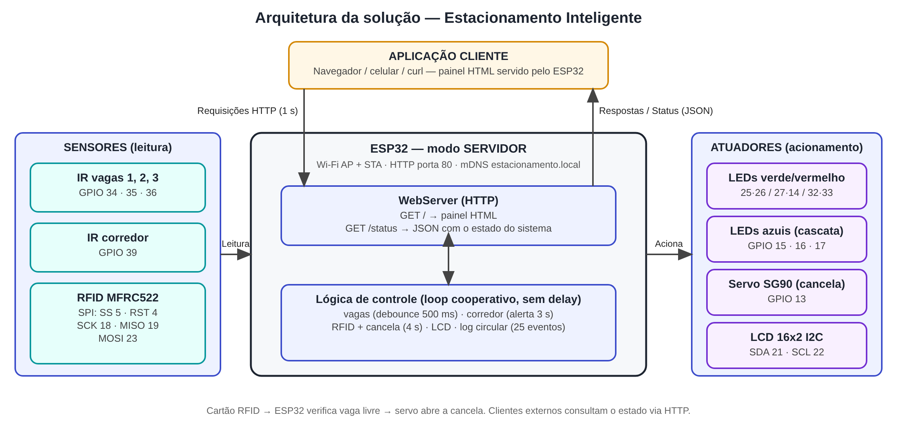
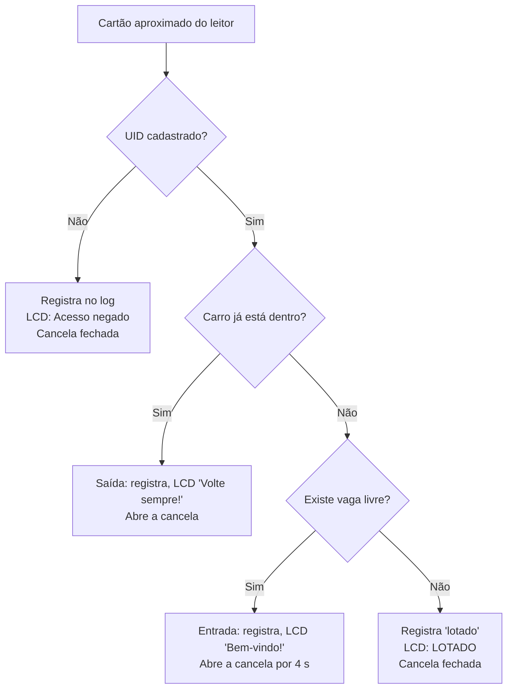
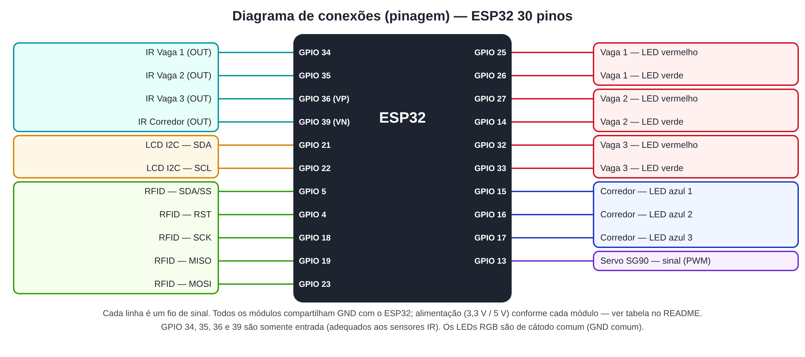

# 🚗 Estacionamento Inteligente

Maquete interativa de um estacionamento inteligente, controlada por um único microcontrolador **ESP32**, com monitoramento individual das vagas, alerta de tráfego cruzado no corredor, controle de acesso por **RFID** com cancela automatizada e um **painel web em tempo real** hospedado na própria placa.


> Projeto acadêmico de **Engenharia de Software / Conectividade de Sistemas Ciberfísicos** · PUCPR · Docente orientador: **Prof. Fábio Bettio** · Período letivo: **2026/02**

---

## 📚 Sumário

- [📌 Visão Geral](#-visão-geral)
- [❗ Problema](#-problema)
- [⚡ Funcionalidades](#-funcionalidades)
- [👥 Equipe](#-equipe)
- [🏗️ Arquitetura da Solução](#️-arquitetura-da-solução)
- [⚙️ Princípio de Funcionamento](#️-princípio-de-funcionamento)
- [🛠️ Hardware Utilizado](#️-hardware-utilizado)
- [🔌 Diagrama de Conexões (Pinagem)](#-diagrama-de-conexões-pinagem)
- [🌐 Documentação da API / Comunicação](#-documentação-da-api--comunicação)
- [🚀 Instruções de Instalação e Execução](#-instruções-de-instalação-e-execução)
- [🧪 Testes de Bancada](#-testes-de-bancada)
- [🎬 Vídeo Demonstrativo e Screenshots](#-vídeo-demonstrativo-e-screenshots)
- [🗂️ Estrutura do Repositório](#️-estrutura-do-repositório)
- [💰 Custos](#-custos)
- [🎯 Escopo](#-escopo)
- [🔎 Estado da Arte](#-estado-da-arte)
- [⚠️ Riscos e Desafios Técnicos](#️-riscos-e-desafios-técnicos)
- [📅 Cronograma](#-cronograma)

---

## 📌 Visão Geral

A solução consiste na construção de uma maquete interativa de um estacionamento inteligente, cujo gerenciamento é centralizado em um microcontrolador **ESP32**. O sistema atua na dificuldade de localização de vagas e na sinalização do fluxo de veículos, fornecendo orientações visuais no local físico (LEDs e display LCD) e exibindo a disponibilidade de forma remota.

O diferencial do projeto é rodar a **lógica de controle** e o **servidor web** simultaneamente na mesma placa, exibindo a disponibilidade das vagas em tempo real, sem depender de plataformas externas em nuvem. O ESP32 opera como **servidor HTTP na porta 80**, atendendo qualquer cliente na mesma rede (navegador, celular ou `curl`).

---

## ❗ Problema

A dificuldade diária na busca por vagas em estacionamentos gera perda de tempo, estresse para os condutores e ineficiência logística para os administradores desses espaços. Sem um sistema de sinalização claro, os motoristas precisam circular aleatoriamente para encontrar um local livre e ficam expostos a riscos de pequenas colisões devido à falta de visibilidade do tráfego cruzado nos corredores durante as manobras de saída.

---

## ⚡ Funcionalidades

- 🅿️ **Monitoramento individual das vagas:** um sensor infravermelho em cada uma das 3 vagas detecta a presença de veículos. LEDs **verdes** e **vermelhos** indicam se o espaço está livre ou ocupado. A leitura precisa ficar estável por 500 ms para mudar o estado (evita "piscar" quando algo passa rapidamente na frente do sensor).
- 🚦 **Gestão de tráfego cruzado:** um sensor adicional monitora o corredor. Ao detectar um veículo, o sistema aciona os LEDs **azuis** em cascata, sinalizando que a manobra de saída está temporariamente bloqueada. O alerta permanece por 3 s após o veículo passar.
- 🔐 **Controle de acesso e cancela:** leitor RFID (MFRC522). Ao aproximar um cartão ou chaveiro cadastrado, o ESP32 verifica se há vaga livre e, em caso positivo, aciona a cancela por um servomotor SG90 (aberta por 4 s). Se não houver vaga, a cancela permanece fechada. Cartões não cadastrados têm o acesso negado; a saída é sempre liberada.
- 📟 **Display LCD 16x2 (I2C):** mostra vagas livres, estado da cancela, estado de cada vaga e mensagens ("Bem-vindo!", "LOTADO", "Acesso negado", IP da placa).
- 🌐 **Interface web em tempo real:** o ESP32 atua como servidor web independente, mostrando quais das 3 vagas estão livres ou ocupadas, o estado da cancela, o alerta de corredor e o último acesso registrado, com atualização automática a cada 1 s.
- 📝 **Log de eventos com horário:** cada evento (entrada, saída, ocupação/liberação de vaga, cancela, corredor) é registrado em um log circular de 25 entradas, exibido no painel e na porta serial.
- 📡 **Rede sempre disponível:** o ESP32 cria o próprio ponto de acesso Wi-Fi (`Estacionamento-IoT`) e, opcionalmente, conecta-se a uma rede com internet para obter a hora real via NTP.

### Exemplo de log de eventos (formato gerado pelo firmware)

```
14:03:21 - Cartao A5 2F 3C 11 (Cartao branco) entrou
14:03:21 - Cancela aberta
14:03:23 - Vaga 03 ocupada
14:03:25 - Cancela fechada
15:17:48 - Cartao A5 2F 3C 11 (Cartao branco) saiu
15:17:48 - Cancela aberta
15:17:49 - Vaga 03 liberada
15:17:52 - Cancela fechada
```

> Sem acesso à internet o horário é exibido como tempo desde que a placa ligou (`+HH:MM:SS`).

### Exemplo do painel web (ilustrativo)

| Vaga    | Status     |
| ------- | ---------- |
| Vaga 01 | 🟢 LIVRE   |
| Vaga 02 | 🔴 OCUPADA |
| Vaga 03 | 🟢 LIVRE   |

*Vagas livres: 2 / 3 · Cancela: FECHADA · Último acesso: Entrada A5 2F 3C 11 às 14:03:21*

---

## 👥 Equipe

| Nome | RA | GitHub | Papel | Responsabilidades |
| --- | --- | --- | --- | --- |
| Chadi Waked | 40125527 | [@3chadi](https://github.com/3chadi) | Estrutura de Rede e IoT | Comunicação Wi-Fi e servidor web interno no ESP32 |
| Edson Vinícius Pereira dos Santos | 40125034 | [@edsonvsantos](https://github.com/edsonvsantos) | Desenvolvedor de Firmware | Lógica de controle no ESP32: leitura dos sensores e acionamento dos LEDs e da cancela |
| Edward Alves Souza | 40132657 | [@edwsz](https://github.com/edwsz) | Hardware e Eletrônica | Montagem física do circuito (ESP32, sensores IR, LEDs e servomotor) |
| Leonardo Neves da Rocha Melo | 40107214 | [@neves-leonardo](https://github.com/neves-leonardo) | Desenvolvedor Front-end | Interface web com status de ocupação das vagas em tempo real |
| Pedro Viana Cherobim | 40125889 | [@vianapedro851](https://github.com/vianapedro851) | Qualidade & Documentação | Testes gerais e documentação do projeto |

---

## 🏗️ Arquitetura da Solução

O ESP32 é o núcleo do sistema e concentra três funções:

1. Leitura dos sensores infravermelhos de cada vaga e do sensor do corredor, para atualizar a sinalização por LEDs e o LCD;
2. Controle de acesso: a leitura de um cartão no módulo RFID dispara a verificação de disponibilidade de vaga e, havendo vaga livre, aciona o servomotor que abre a cancela;
3. Hospedagem de um **servidor HTTP embarcado** (porta 80) que publica o painel HTML e uma rota JSON (`/status`) com o estado completo do sistema.



### Lógica de controle de acesso via RFID



> **Vagas livres** = `3 − max(vagas ocupadas pelos sensores, cartões atualmente "dentro")`. Assim, um carro que acabou de entrar já é contado antes de parar na vaga.

### Estrutura do firmware

O `loop()` não usa `delay()`: cada função executa um pouco e devolve o controle, de modo que o servidor web, os sensores e o RFID respondem "ao mesmo tempo" (multitarefa cooperativa).

| Função | Responsabilidade |
| --- | --- |
| `servidor.handleClient()` | Atende as requisições HTTP pendentes |
| `atualizarVagas()` | Lê os 3 sensores com debounce de 500 ms; acende LED verde/vermelho; registra mudanças |
| `atualizarCorredor()` | Detecta veículo no corredor; mantém alerta por 3 s; anima LEDs azuis em cascata (200 ms por passo) |
| `atualizarRfid()` | Lê o UID, valida o cartão, decide entrada/saída/negado/lotado |
| `atualizarCancela()` | Fecha a cancela após o tempo configurado |
| `atualizarLcd()` | Atualiza o display até 4× por segundo, apenas quando o texto muda |
| `verificarWifi()` | Ao conectar na rede com internet: mostra o IP no LCD e inicia o NTP (UTC−3) |

### Constantes de tempo e ângulos (configuráveis no topo do `.ino`)

| Constante | Valor | Significado |
| --- | --- | --- |
| `ANG_FECHADA` / `ANG_ABERTA` | 0° / 90° | Posições do servo |
| `TEMPO_ABERTA_MS` | 4000 | Tempo com a cancela aberta |
| `ALERTA_CORREDOR_MS` | 3000 | Duração do alerta azul após o veículo passar |
| `ESTABILIDADE_MS` | 500 | Tempo de leitura estável para mudar o estado de uma vaga |
| `TAM_LOG` | 25 | Quantidade de eventos mantidos no log |

---

## ⚙️ Princípio de Funcionamento

1. **Leitura do RFID:** o usuário aproxima o cartão ou chaveiro cadastrado do leitor MFRC522.
2. **Verificação de vaga:** o ESP32 consulta o estado das 3 vagas (sensores IR) e os cartões que já estão no estacionamento.
3. **Controle da cancela:** havendo vaga livre, o servomotor SG90 abre a cancela; caso contrário, ela permanece fechada.
4. **Sinalização das vagas:** o estado de cada vaga é refletido nos LEDs verde (livre) e vermelho (ocupada) e no LCD.
5. **Sinalização do corredor:** o sensor do corredor detecta veículos passando e aciona os LEDs azuis em cascata, indicando saída bloqueada.
6. **Registro de eventos:** entrada, ocupação, liberação e saída são registradas em log com horário.
7. **Painel web:** o servidor embarcado publica o estado atualizado; o navegador consulta `/status` a cada 1 s.

---

## 🛠️ Hardware Utilizado

| Componente | Qtd. | Função no projeto |
| --- | --- | --- |
| ESP32 (módulo Wi-Fi/Bluetooth, 30 pinos) | 1 | Microcontrolador central: lógica de controle, rede e servidor HTTP |
| Sensor de obstáculos reflexivo infravermelho (módulo LM393) | 8 comprados, 4 em uso | 3 para a ocupação das vagas + 1 para o fluxo no corredor |
| Leitor RFID MFRC522 (13,56 MHz) com cartão e chaveiro | 1 | Controle de acesso |
| Micro servo motor SG90 9g | 1 | Acionamento da cancela |
| LED RGB difuso 5 mm, cátodo comum | 6 | Sinalização: verde/vermelho (vagas) e azul (corredor) |
| Display LCD 16x2 com backlight azul e módulo I2C | 1 | Vagas livres, estado da cancela e mensagens |
| Resistores de 100 Ω e de 220 Ω | 10 de cada | Limitação de corrente dos LEDs |
| Protoboard 830 pontos e jumpers (30 M/F e 52 M/M) | 1 + 82 | Montagem do circuito |
| Materiais da maquete (isopor, fita, palitos, papel, tesoura) | ver [Custos](#-custos) | Base, paredes e pista |

### Alimentação

| Módulo | Tensão | Observação |
| --- | --- | --- |
| MFRC522 | **3,3 V** | Não tolera 5 V |
| Sensores IR (LM393) | 3,3 V (recomendado) | Alimentados em 3,3 V a saída digital não excede a tolerância das entradas do ESP32 |
| LCD 16x2 + I2C | 5 V | Pino `VIN`/5 V da placa |
| Servo SG90 | 5 V | Pino `VIN`/5 V da placa; se a cancela tremer ou a placa reiniciar ao acionar, usar fonte de 5 V dedicada com GND comum |
| LEDs | via GPIO | Usar resistor em série em cada canal |

> A alimentação acima é a recomendação de projeto; confirme na montagem física.

---

## 🔌 Diagrama de Conexões (Pinagem)



| Função | GPIO | Observação |
| --- | --- | --- |
| Sensor IR — Vaga 1 / 2 / 3 | 34 / 35 / 36 (VP) | Entradas digitais; `LOW` = objeto detectado |
| Sensor IR — Corredor | 39 (VN) | Entrada digital; `LOW` = veículo detectado |
| LED vermelho — Vaga 1 / 2 / 3 | 25 / 27 / 32 | Aceso = vaga ocupada |
| LED verde — Vaga 1 / 2 / 3 | 26 / 14 / 33 | Aceso = vaga livre |
| LED azul — Corredor 1 / 2 / 3 | 15 / 16 / 17 | Cascata quando há veículo no corredor |
| Servo SG90 (cancela) | 13 | PWM 50 Hz, pulso 500–2400 µs |
| RFID MFRC522 | SS 5 · RST 4 · SCK 18 · MISO 19 · MOSI 23 | Barramento SPI |
| LCD I2C | SDA 21 · SCL 22 | Endereço padrão `0x27` (confirme com `T06_Scanner_I2C`) |

---

## 🌐 Documentação da API / Comunicação

**Protocolo:** HTTP · **Servidor:** `WebServer` do ESP32 · **Porta:** 80 · **Formato de dados:** JSON (UTF-8)

**Como acessar o servidor:**

| Modo | Endereço |
| --- | --- |
| Rede própria do ESP32 (sempre ativa): SSID `Estacionamento-IoT` | `http://192.168.4.1` |
| mDNS (na rede em que o cliente estiver conectado) | `http://estacionamento.local` |
| Rede com internet configurada em `WIFI_NOME` | IP exibido no LCD e na serial |

### Endpoints

| Método | Rota | Descrição | Resposta |
| --- | --- | --- | --- |
| `GET` | `/` | Painel web (HTML + JavaScript embutidos no firmware) | `200 text/html` |
| `GET` | `/status` | Estado completo do sistema (leitura dos sensores e atuadores) | `200 application/json` |
| qualquer | demais rotas | Rota inexistente | `404` padrão da biblioteca |

### `GET /status`

Exemplo de resposta:

```json
{
  "vagas": [false, true, false],
  "livres": 2,
  "cancela": false,
  "corredor": false,
  "hora": "14:03:21",
  "ultimo": "Entrada A5 2F 3C 11 as 14:03:21",
  "log": [
    "14:03:21 - Cartao A5 2F 3C 11 (Cartao branco) entrou",
    "14:03:21 - Cancela aberta",
    "14:03:23 - Vaga 02 ocupada"
  ]
}
```

| Campo | Tipo | Descrição |
| --- | --- | --- |
| `vagas` | `bool[3]` | Estado de cada vaga; `true` = ocupada |
| `livres` | `int` | Vagas livres (considera sensores e cartões "dentro") |
| `cancela` | `bool` | `true` = cancela aberta |
| `corredor` | `bool` | `true` = veículo no corredor (saída bloqueada) |
| `hora` | `string` | `HH:MM:SS` (NTP) ou `+HH:MM:SS` (tempo desde que a placa ligou) |
| `ultimo` | `string` | Último acesso por RFID (`"nenhum"` até o primeiro) |
| `log` | `string[]` | Até 25 eventos, do mais antigo ao mais recente |

### Exemplos de chamada

```bash
# Linux / macOS / Git Bash
curl http://192.168.4.1/status
```

```powershell
# Windows PowerShell
curl.exe http://192.168.4.1/status
Invoke-RestMethod http://192.168.4.1/status
```

### Cliente web

O painel (`GET /`) é a aplicação cliente: executa `fetch('/status')` a cada 1 s e redesenha as vagas, os indicadores (vagas livres, cancela, hora), o alerta de corredor e o log. Se a placa deixar de responder, o rodapé passa a exibir **"Sem conexao com a placa..."**, indicando o estado da conexão.

---

## 🚀 Instruções de Instalação e Execução

### Pré-requisitos

- [Arduino IDE](https://www.arduino.cc/en/software) 2.x
- Pacote de placas **esp32 (Espressif Systems) versão 3.x** (Gerenciador de Placas)
- Cabo USB de dados e a montagem do circuito conforme a [pinagem](#-diagrama-de-conexões-pinagem)

### Bibliotecas (Gerenciador de Bibliotecas)

| Biblioteca | Autor |
| --- | --- |
| MFRC522 | GithubCommunity |
| ESP32Servo | Kevin Harrington |
| LiquidCrystal I2C | Frank de Brabander |

`WiFi`, `WebServer`, `ESPmDNS`, `SPI`, `Wire` e `time.h` já acompanham o pacote da placa.

### Passo a passo

1. Clone o repositório:
   ```bash
   git clone https://github.com/ES-PUCPR/estacionamento-inteligente.git
   ```
2. Abra `Estacionamento_Inteligente/Estacionamento_Inteligente.ino` na Arduino IDE.
3. Selecione a placa **NodeMCU-32S** (ou **ESP32 Dev Module**) e a porta COM correta.
4. Descubra o endereço do LCD com `testes/T06_Scanner_I2C` e ajuste `LCD_ENDERECO` se não for `0x27`.
5. Descubra o UID dos seus cartões com `testes/T08_RFID` e substitua os UIDs do vetor `cartoes[]`.
6. *(Opcional)* Para ter a hora real no log, preencha `WIFI_NOME` e `WIFI_SENHA` com uma rede 2,4 GHz. **Não faça commit dessas credenciais.** Deixe `""` para usar apenas a rede do ESP32.
7. Clique em **Carregar (Upload)**. Abra o Monitor Serial em **115200 baud** para ver o log e os endereços.
8. No celular ou computador, conecte-se à rede Wi-Fi **`Estacionamento-IoT`** (a senha é a constante `AP_SENHA` do código) e abra **http://192.168.4.1**.
9. Valide a API: `curl http://192.168.4.1/status`.

### Demonstração rápida

| Ação | Resultado esperado |
| --- | --- |
| Colocar um objeto na frente do sensor de uma vaga por mais de 0,5 s | LED da vaga vira vermelho; painel e LCD mostram "OCUPADA"; evento no log |
| Passar um objeto no sensor do corredor | LEDs azuis em cascata; alerta azul no painel por pelo menos 3 s |
| Aproximar cartão cadastrado com vaga livre | "Bem-vindo!" no LCD; servo abre a cancela por 4 s; "Último acesso" atualizado |
| Aproximar cartão com 3 vagas ocupadas | "LOTADO" no LCD; cancela permanece fechada |
| Aproximar cartão não cadastrado | "Acesso negado" no LCD; evento no log |

---

## 🧪 Testes de Bancada

Cada módulo foi isolado em um sketch próprio (pasta [`testes/`](testes)), seguindo a recomendação de validar os componentes individualmente antes da integração.

| Sketch | O que valida |
| --- | --- |
| `T01_Blink` | Placa responde e grava; pisca o LED onboard (GPIO 2) e escreve na serial |
| `T02_WiFi` | Varre as redes, conecta a uma rede 2,4 GHz e imprime o IP |
| `T03_LEDs` | Acende um LED por vez (9 canais) informando o nome e o GPIO na serial |
| `T04_Sensores_IR` | Lê os 4 sensores IR e imprime `OBJETO`/`livre` a cada 300 ms |
| `T05_Servo` | Move o servo entre 0° (fechada) e 90° (aberta) |
| `T06_Scanner_I2C` | Varre o barramento I2C e informa o endereço do LCD |
| `T07_LCD` | Escreve uma mensagem de teste no display |
| `T08_RFID` | Verifica a versão do MFRC522 e imprime o UID dos cartões |
| `T09_Web_Sensor` | Prova de conceito: 1 sensor + servidor web + log, com rede própria `Teste-Vaga` |

---

## 🎬 Vídeo Demonstrativo e Screenshots

> 🚧 Seção a ser preenchida quando a maquete física estiver montada.

<!-- TODO: adicionar foto da maquete em docs/maquete.jpg -->
<!-- TODO: adicionar captura do painel web em docs/painel.png -->
<!-- TODO: adicionar link do vídeo demonstrativo -->

---

## 🗂️ Estrutura do Repositório

```
estacionamento-inteligente/
├── Estacionamento_Inteligente/
│   └── Estacionamento_Inteligente.ino   # Firmware principal (servidor HTTP + controle)
├── testes/                              # Sketches de validação T01–T09
├── docs/
│   ├── arquitetura.png                  # Diagrama de arquitetura
│   └── pinagem.png                      # Diagrama de conexões
├── README.md
└── .gitignore
```

---

## 💰 Custos

Lista de materiais (BOM). Os itens 01 a 09 foram adquiridos em 03/09/26; os materiais da maquete (14 a 18) foram comprados em 06/11/2026 (cupom fiscal eletrônico da Distribuidora Curitiba de Papéis e Livros S/A).

| # | Item | Qtd. | Preço Unit. (R$) | Preço Total (R$) |
| --- | --- | --- | --- | --- |
| 01 | Módulo Wi-Fi ESP32 Bluetooth, 30 pinos | 1 | 44,85 | 44,85 |
| 02 | Display LCD 16x2 com Backlight Azul e I2C | 1 | 24,90 | 24,90 |
| 03 | Protoboard 830 Pontos | 1 | 11,90 | 11,90 |
| 04 | Sensor de Obstáculos Reflexivo Infravermelho LM393 | 8 | 5,90 | 47,20 |
| 05 | Micro Servo Motor SG90 9g 180° | 1 | 14,90 | 14,90 |
| 06 | Kit Módulo RFID MFRC522 13.56 MHz | 1 | 13,40 | 13,40 |
| 07 | LED RGB Difuso 5mm — Cátodo Comum | 6 | 0,80 | 4,80 |
| 08 | Jumpers Macho/Fêmea, 20 un. | 1 | 4,90 | 4,90 |
| 09 | Jumpers Macho/Macho, 20 un. | 1 | 4,90 | 4,90 |
| 10 | Jumpers Macho/Fêmea, 10 un. | 1 | 9,00 | 9,00 |
| 11 | Jumpers Macho/Macho, 32 un. | 1 | 7,26 | 7,26 |
| 12 | Resistores 100 Ω, 10 un. | 1 | 2,00 | 2,00 |
| 13 | Resistores 220 Ω, 10 un. | 1 | 2,00 | 2,00 |
| 14 | Placa de isopor 20 mm | 1 | 15,60 | 15,60 |
| 15 | Fita de empacotamento | 1 | 9,40 | 9,40 |
| 16 | Tesoura escolar | 1 | 19,90 | 19,90 |
| 17 | Palitos para sorvete | 1 | 11,10 | 11,10 |
| 18 | Papel sulfite 40 kg | 1 | 12,50 | 12,50 |

| Resumo | Valor (R$) |
| --- | --- |
| Subtotal dos itens 01–09 | 171,75 |
| Frete (itens 01–09) | 13,70 |
| **Consolidado com frete (itens 01–09)** | **185,45** |
| Itens complementares (10–13): jumpers e resistores | 20,26 |
| Materiais da maquete (14–18) | 68,50 |
| **Custo total da solução** | **274,21** |

> **Nota:** o frete dos itens 10 a 13 não foi informado e não está incluído no total.

---

## 🎯 Escopo

O escopo limita-se à montagem e validação de uma **maquete funcional** com **3 vagas físicas** e um **corredor principal de cruzamento**. A camada de software e conectividade está restrita à comunicação direta via servidor embarcado local na placa, **sem bancos de dados complexos** e **sem dependência de infraestrutura robusta em nuvem**.

**Limitações conhecidas:** o log e o estado "dentro/fora" dos cartões ficam em RAM e são perdidos ao reiniciar a placa; a lista de cartões cadastrados é fixa no código; o painel não possui autenticação (uso restrito à rede local da maquete).

---

## 🔎 Estado da Arte

Projetos de referência analisados e o diferencial desta solução:

| # | Projeto | Contribuição / Diferencial do nosso projeto |
| --- | --- | --- |
| 1 | [smart-parking-system_iot-Based](https://github.com/saichaitanya-c/smart-parking-system_iot-Based) (saichaitanya-c, 2026) | Projeto mais básico: ESP32 + sensores IR exibindo status em tela no acesso, sem servidor web próprio nem controle de acesso. Nossa solução adiciona interface web embarcada, cancela por RFID e gestão do corredor de tráfego cruzado. |
| 2 | IoT-Based Smart Parking Management System (ESP32, Blynk, ThingSpeak), Roshan Sahu | Projeto mais amplo, usado só como referência lógica: depende de plataforma externa (Blynk/ThingSpeak). O nosso roda cliente e servidor web inteiramente no ESP32, sem nuvem. |
| 3 | [Real-time Parking Monitoring System](https://github.com/Arfazrll/Real-time-Parking-Monitoring-System) (Arfazrll) | Projeto com RFID e API. Nosso diferencial: dashboard e lógica embarcados no ESP32 (sem backend PHP/banco externo) e sinalização dedicada de tráfego cruzado. |
| 4 | [RFID-based Smart Parking System using ESP32](https://github.com/Muhaiminul-Hasan/RFID-based-Smart-Parking-System-using-ESP32) (Muhaiminul-Hasan) | Referência direta para o controle de acesso via RFID. Nosso diferencial: monitoramento individual das vagas com LEDs verde/vermelho e alerta de tráfego cruzado com LEDs azuis. |
| 5 | [IoT Based Smart Parking System](https://www.researchgate.net/publication/381814507_IoT_Based_Smart_Parking_System) (Abdulsaheb, Nafea, Al-Jawher & Hayyawi, 2024) | Artigo acadêmico usado como referência de arquitetura de sensores. Nosso diferencial: ESP32 (Wi-Fi nativo) em vez de NodeMCU + nuvem externa, com painel web local em tempo real. |

---

## ⚠️ Riscos e Desafios Técnicos

| Desafio | Impacto | Causa | Mitigação |
| --- | --- | --- | --- |
| Concorrência entre lógica de controle e servidor web no mesmo ESP32 | Médio | Leitura de sensores/RFID, acionamento do servo e servidor web simultâneos podem causar travamentos ou atrasos na interface | `loop()` cooperativo sem `delay()`: cada função faz uma pequena parte e devolve o controle; o painel consulta `/status` apenas a cada 1 s |
| Leituras instáveis dos sensores IR | Médio | Reflexos, luz ambiente e objetos passando rapidamente na frente do sensor | Debounce de 500 ms nas vagas e alerta de corredor mantido por 3 s; sensibilidade ajustável no trimpot do módulo |
| Falha ou ausência da rede Wi-Fi externa | Médio | Rede indisponível, senha errada ou rede 5 GHz | O ESP32 mantém sempre o próprio ponto de acesso (`Estacionamento-IoT`); sem NTP o log usa o tempo desde o boot |
| Queda de tensão ao acionar o servo | Médio | O SG90 puxa corrente no momento do movimento e pode reiniciar o ESP32 | Alimentar o servo em 5 V com GND comum; se necessário, usar fonte dedicada |
| Perda de estado ao reiniciar | Baixo | Log e estado "dentro/fora" dos cartões ficam apenas em RAM | Limitação aceita no escopo da maquete (sem banco de dados) |

---

## 📅 Cronograma

| Marco | Prazo | Entregas | Responsável | Status |
| --- | --- | --- | --- | --- |
| M1: Definição & Pesquisa | Mês 1 | Escopo formalizado, levantamento de requisitos e referências | Equipe | ✅ Concluído |
| M2: Arquitetura & BOM | Mês 2 | Diagrama de blocos, esquemático inicial e lista de compras | Edson Santos | 🔄 Em andamento |
| M3: Prototipagem Alpha | Mês 3 | Testes em bancada, validação individual dos módulos/sensores | Pedro Viana | ⏳ Não iniciado |
| M4: Integração dos Sistemas | Mês 4 | Unificação de hardware, firmware e estrutura mecânica | Equipe | ⏳ Não iniciado |
| M5: Validação & Banca Final | Mês 5 | Protótipo funcional, testes reais e relatório final | Equipe | ⏳ Não iniciado |

---

📎 Repositório: [ES-PUCPR/estacionamento-inteligente](https://github.com/ES-PUCPR/estacionamento-inteligente)